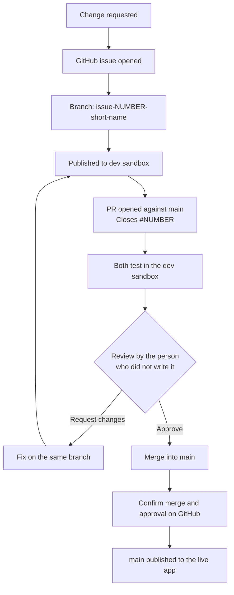

# Dugout Standard App

Source for **Coach Rob's MVPs**, a youth team effort tracker (workouts, culture points, MVP race, effort scouting reports). Single self-contained page: `index.html`.

## Environments

| Environment | Source | Where | Who can change it |
|---|---|---|---|
| **Prod** | `main` | Live app artifact on claude.ai | Published only after a PR is approved and merged |
| **GitHub Pages** | `main` | Public web copy of `index.html` (if Pages is on) | Updates automatically on every merge to `main` |
| **Dev sandbox** | feature branch | Separate dev artifact, labeled "DEV SANDBOX" | Updated freely for testing, no approval needed |

`main` always matches what is live. Nothing reaches prod without an approved, merged PR.

## Process flow

## Steps

| # | Step | Who | Where |
|---|---|---|---|
| 1 | Request a change | Any maintainer | Chat with Claude, or a new issue |
| 2 | Open an issue describing the change | Claude or the requester | This repo, Issues |
| 3 | Make the change on `issue-<number>-short-name` | Claude or the author | This repo |
| 4 | Publish the branch to the dev sandbox | Author (no approval needed) | Dev sandbox |
| 5 | Open a PR against `main` with `Closes #<number>`, what changed and how it was tested | Author | This repo, Pull requests |
| 6 | Click through the change in the dev sandbox | Both maintainers | Dev sandbox |
| 7 | Review: **Approve** or **Request changes** | The maintainer who did not write it | PR, Files changed, Review changes |
| 7a | If changes were requested: fix the same branch, republish dev, back to step 6 | Author | Repo and dev sandbox |
| 8 | Merge once approved | Either maintainer | PR page |
| 9 | Confirm the PR is merged and approved, then publish `main` to the live app | Whoever releases (Claude on request, or the owner) | Live app artifact |

## Approval rules

- **The person who didn't write a change approves it.** GitHub never lets authors approve their own PR, so one required approval always comes from the other maintainer.
- **Branch protection on `main` enforces it.** Settings, Branches: require a pull request, require 1 approval, dismiss stale approvals when new commits are pushed, and do not allow bypassing.
- **Nothing is published to the live app** unless its PR is merged and approved. Claude checks both on GitHub before every prod publish.
- **The dev sandbox needs no approval.** It is a private test copy and never touches the live app.

The dev copy differs from `main` only in its title and a header label; those are applied at publish time and never committed.
